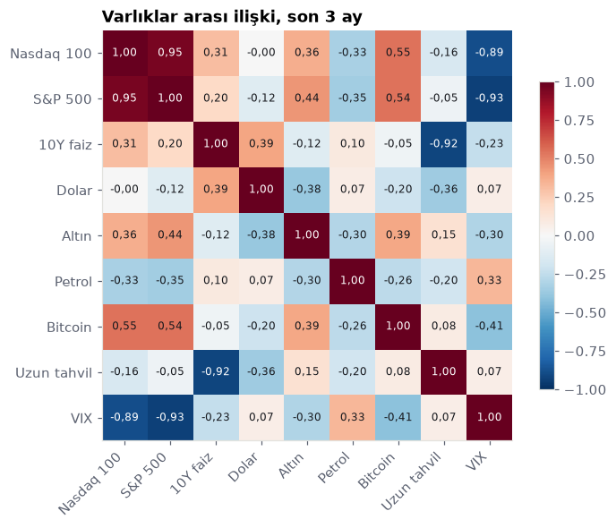
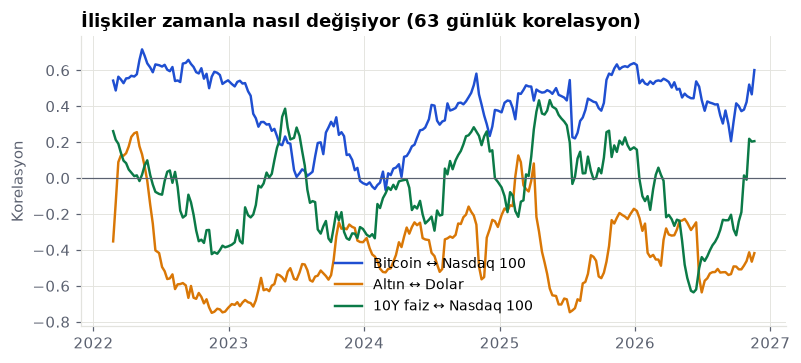
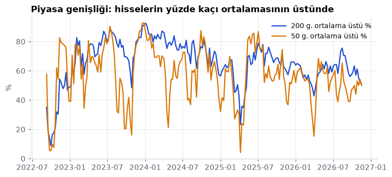
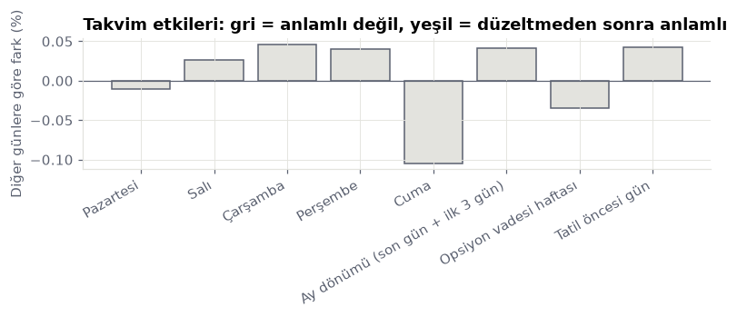

# Haftalık piyasa raporu · 2026-W47

_Otomatik üretildi: 2026-11-20 kapanış verisiyle. Kaynak kod: [`analytics/`](../../analytics). Yatırım tavsiyesi değildir._

## Özet
- Nasdaq 100 düşüş trendinde (200 günlük ortalamanın altında) ve oynaklık uzun dönem normaline göre yüksek. Düşüş trendinde oynaklığın yüksek olması, satışın panik tarafına geçtiğini gösterebilir.
- Son bir ayda en güçlü sektör Sağlık, en zayıfı Yarı iletken. Para savunmacı tarafa kayıyor.
- Bilanço açıklamalarından sonraki iki günde hisseler, sıradan iki günlük dönemlere göre yaklaşık 2,8 kat fazla oynuyor (853 bilanço). İlk tepkinin yönü sonraki iki ayı açıklamıyor (p=0,72): büyük şirketlerde bilanço haberi hızla fiyatlanıyor, sürüklenme görülmüyor.
- Yöneticilerin piyasadan alım yaptığı 14 olayda (14 şirket) hisse sonraki iki ayda piyasaya göre ortalama 13,4 puan fazla getiri sağladı ve fark istatistiksel olarak anlamlı. Ancak olaylar 2026-05 – 2026-08 arasındaki kısa bir döneme yığılmış; aynı piyasa ortamını paylaştıkları için bağımsız sayılmazlar, sonuç daha uzun bir dönemde doğrulanmadan sinyal sayılmamalı.
- Nasdaq 100 hisselerinin yaklaşık yüzde 37 kadarı 200 günlük ortalamasının üstünde ve bu oran son bir ayda düştü. Yükselişi hisselerin azınlığı taşıyor; dar tabanlı yükselişler, öncü birkaç hisse sendelediğinde daha kırılgandır.
- Kümeleme modeline göre piyasa 2 işlem günüdür 'Stres' rejiminde. Geçmişte bu rejimdeki günlerin ardından gelen 20 işlem gününde Nasdaq 100 ortalama yüzde 4,2 değişti ve dönemlerin yüzde 72 kadarında yükseldi. Bu bir tahmin değil, benzer dönemlerin geçmiş davranışı.
- Bir sonraki işlem günü için beklenen Nasdaq 100 aralığı (en yüksek ile en düşük arası) yaklaşık %3,47, yani 869 puan civarı; geçmiş isabete göre 10 günün 8'inde 444 ile 1251 puan arasında kalır. Model, görmediği son dönemde basit kurallardan (dünün aralığı, son ayın ortalaması) yaklaşık yüzde 4 daha isabetli.
- Takvim etkileri 2000 yılından bu yana 20 ayrı iddiayla test edildi: düzeltmesiz bakılınca 1 tanesi anlamlı görünüyor, çoklu test düzeltmesinden sonra 0 tanesi kalıyor. Yaygın takvim efsanelerinin hiçbiri bu veride doğrulanmıyor; çoğu, şans eseri anlamlı görünen sonuçlardan ibaret.
- Son iki haftada getirisi ya da hacmi kendi normalinin çok dışına çıkan varlıklar: ADI, AMAT, AVGO, CEG, CRWV, FAST. Bu günlerin arkasında genellikle bilanço, haber ya da endeks değişikliği olur.

## Sektörler

| Sektör | 1 hafta % | 1 ay % | 3 ay % | Öncü | Geride kalan |
|---|---|---|---|---|---|
| Sağlık | −6,2 | −0,4 | 4,3 | IDXX | ALNY |
| Gıda ve içecek | −3,3 | −0,6 | 1,0 | CCEP | MNST |
| Perakende | −3,2 | −1,1 | −2,6 | COST | MELI |
| Seyahat ve eğlence | −7,2 | −3,5 | −9,8 | MAR | BKNG |
| Enerji ve kamu hizmeti | −5,5 | −3,6 | −3,2 | EXC | FANG |
| İletişim | −7,2 | −5,5 | −12,9 | CMCSA | GOOGL |
| Sanayi | −6,0 | −6,2 | −10,2 | FER | AXON |
| Otomotiv | −7,8 | −7,1 | −11,0 | PCAR | TSLA |
| Havacılık ve uzay | −11,8 | −8,2 | −11,4 | HON | SPCX |
| Ulaştırma | −4,7 | −8,2 | −10,4 | CSX | ODFL |
| Tüketici hizmetleri | −10,6 | −12,7 | −23,4 | PYPL | DASH |
| Teknoloji | −12,0 | −18,3 | −18,0 | APP | NBIS |
| Yarı iletken | −17,0 | −21,5 | −26,1 | NXPI | MRVL |

## Haftanın en çok yükselen ve düşen hisseleri
| Kod | Şirket | 1 hafta % | 1 ay % |
|---|---|---|---|
| PANW | Palo Alto Networks | 6,5 | −3,3 |
| PDD | PDD | 6,0 | 5,7 |
| CRWD | CrowdStrike Holdings | 1,2 | −3,6 |
| ORLY | O Reilly Automotive | 0,5 | 0,7 |
| WMT | Walmart | −0,1 | 5,6 |
| MSTR | Strategy | −30,3 | −46,6 |
| NBIS | Nebius | −29,8 | −48,9 |
| RKLB | Rocket Lab | −26,2 | −11,3 |
| CRWV | CoreWeave | −25,6 | −28,9 |
| MU | Micron Technology | −23,6 | −30,6 |

## Varlıklar arası ilişki

## Risk

## Olağandışı günler (son 10 işlem günü)
Getirisi ya da hacmi, önceki 63 günün ortalamasından en az 3 standart sapma uzak olanlar.

| Tarih | Kod | Getiri | Getiri z | Hacim z |
|---|---|---|---|---|
| 2026-11-09 | ADI | 8,6 | 3,5 | 1,6 |
| 2026-11-09 | AMAT | 11,4 | 3,3 | 1,4 |
| 2026-11-09 | AVGO | 8,8 | 3,4 | 1,5 |
| 2026-11-09 | CEG | 10,5 | 3,4 | 2,1 |
| 2026-11-09 | MPWR | 16,6 | 4,7 | 1,9 |
| 2026-11-09 | NVDA | −4,3 | −1,6 | 4,7 |
| 2026-11-09 | PCAR | 3,7 | 3,1 | 1,0 |
| 2026-11-09 | VIX | −5,7 | −3,1 | — |
| 2026-11-10 | NVDA | −5,5 | −2,0 | 3,8 |
| 2026-11-10 | TTWO | 8,3 | 4,0 | 3,4 |
| 2026-11-11 | CRWV | 24,7 | 4,8 | 2,5 |
| 2026-11-12 | KDP | −7,4 | −4,2 | 2,8 |

## Piyasa genişliği ve yoğunlaşma

| Kod | Endekse katkı (puan) | Getiri % | Ağırlık % |
|---|---|---|---|
| AAPL | 1,16 | 10,5 | 11,1 |
| WMT | 0,42 | 20,1 | 2,1 |
| COST | 0,14 | 13,6 | 1,1 |
| CRWD | 0,10 | 20,3 | 0,5 |
| GILD | 0,06 | 14,1 | 0,5 |

## Piyasa rejimi (kümeleme)

Bugün: **Stres** (2 işlem günüdür). Rejimler oynaklık, trend, 200 günlük ortalamaya uzaklık, VIX ve genişlikten k-ortalamalar ile çıkarıldı; tablo betimleyicidir.

| Rejim | Gün payı % | Oynaklık % | 3 ay getiri % | Sonraki 20 gün ort. % | Yükselme oranı % |
|---|---|---|---|---|---|
| Güçlü yükseliş | 37 | 16 | 13,9 | 1,1 | 65 |
| Kararsız | 41 | 19 | 4,0 | 1,7 | 69 |
| Düzeltme | 14 | 24 | −3,1 | 3,1 | 63 |
| Stres | 7 | 39 | −9,1 | 4,2 | 72 |

## Ertesi gün aralık tahmini

Beklenen aralık: **869 puan** (%3,47); 10 günün 8'inde 444–1251 puan.

| Yöntem | Ort. mutlak hata | R² |
|---|---|---|
| Model (logaritmik HAR + VIX) | 0,459 | 0,23 |
| Yarın dün gibi | 0,548 | −0,15 |
| Yarın son ayın ortalaması | 0,478 | 0,12 |

Sınama: 2025-06-03 – 2026-11-19, ileriye doğru yürüyen pencere (aylık yeniden eğitim).

## Takvim etkileri

2000–2026, 6762 gün, 20 iddia. Düzeltmesiz anlamlı: 1, Benjamini–Hochberg sonrası: 0.

## Araştırma: Bilanço sonrası fiyat davranışı

853 bilanço açıklaması (91 şirket, 2023-08-03 – 2026-09-24). Anormal getiri piyasa modeliyle hesaplandı (her olay için önceki 220 günde hissenin Nasdaq 100'e duyarlılığı).

| İlk tepki grubu | Olay | Sonraki 2 ay ort. anormal getiri % | t | p |
|---|---|---|---|---|
| olumsuz | 285 | 0,70 | 0,63 | 0,532 |
| nötr | 284 | −1,34 | −1,89 | 0,060 |
| olumlu | 284 | 0,18 | 0,18 | 0,854 |

Olumlu ve olumsuz grup farkı: −0,53 puan (Welch t-testi p=0,724). Tepki ile sonraki getiri arasındaki sıra korelasyonu: 0,007 (p=0,848).

## Veri kalitesi
- Otomatik kontroller: 3/8 geçti.
- Fiyat kaynakları uyuşuyor: 1 sorun (SNDK)
- Fiyatlar güncel: geçti
- Günlük %50 üstü hareket yok: geçti
- Finansallar güncel: geçti
- Gelir tablosu kendi içinde tutarlı: 1 sorun (MELI)
- Bilanço denkliği: 1 sorun (MSTR)
- Piyasa değeri ile hisse sayısı tutarlı: 1 sorun (CMCSA)
- Para birimi: 3 sorun (ASML, CCEP, FER)
- 107 varlıkta 200 günden uzun temiz fiyat geçmişi var.
- Temizleme sırasında 1 tek günlük hatalı fiyat düzeltildi.
